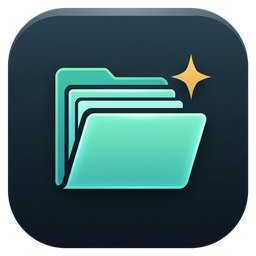



  

<h1 align="center">FileOrganizer for Windows</h1>

  Fast, lightweight Windows file organizer, Cloud Hub (Google Drive / OneDrive / Dropbox), Junk Cleaner, Safe Registry Cleaner, and built-in 1-click Auto-Updater.

  

## Download

- **Desktop App (GUI)**: [Download o-gui.exe (Latest — v0.1.3)](https://github.com/muhamadmaulanarizki/FileOrganizer-Download/releases/latest/download/fo-gui.exe)
- **Command-Line Tool (CLI)**: [Download o-cli.exe (Latest — v0.1.3)](https://github.com/muhamadmaulanarizki/FileOrganizer-Download/releases/latest/download/fo-cli.exe)
- **All Releases**: [Releases Page](https://github.com/muhamadmaulanarizki/FileOrganizer-Download/releases)

> **Auto-Update 1-Klik**: Mulai versi 0.1.1, FileOrganizer otomatis mengecek update saat dibuka dan menampilkan tombol **"Update Sekarang"** (bisa juga cek manual di tab **Settings → Cek Update**).

## Jika Muncul Peringatan Windows SmartScreen

Karena aplikasi ini belum menggunakan sertifikat *Code Signing* berbayar, Windows terkadang menampilkan layar **"Windows protected your PC"** saat pertama kali dibuka:

1. Klik **More info** (Info selengkapnya) → klik **Run anyway** (Tetap jalankan).
2. *(Opsional)* Klik kanan o-gui.exe → **Properties** → centang **Unblock** di bagian bawah → klik **OK**.

## Quick Start

1. Download **o-gui.exe** dan jalankan langsung (tanpa installer).
2. **Organize Folders**: Pilih folder (misalnya Downloads) → klik **Dry-Run Preview** → **Organize Now**. Klik **Undo Last** kapan saja jika ingin mengembalikan file.
3. **Connect Google Drive / Cloud**: Buka **Cloud Hub** → klik **Connect Cloud**. Jika 
clone belum terpasang, klik **Pasang Cloud Engine Otomatis** (1 klik), lalu login via browser.
4. **Junk & Registry Cleaner**: Buka **Junk Cleaner** untuk bersihkan file sampah atau pindah ke tab **Registry** (otomatis membuat backup .reg sebelum setiap perbaikan).

## License

MIT License — see [LICENSE](LICENSE).

